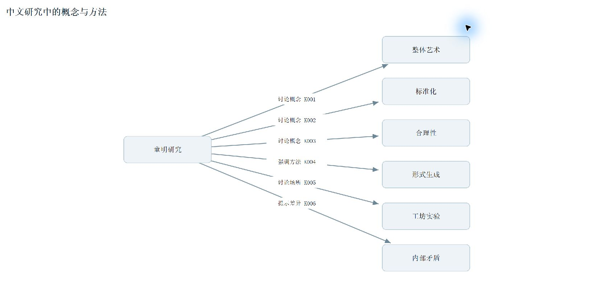
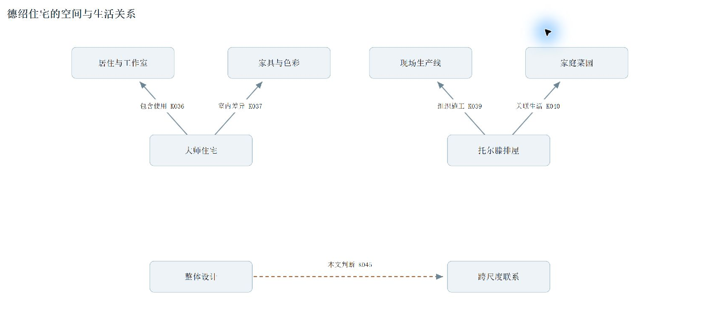
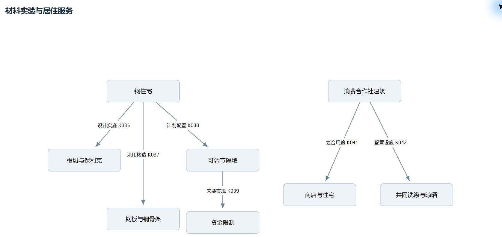

# 德绍住宅生活边界与空间协同专题知识库

本版根据中文研究重建。问题是德绍住宅组织了哪些生活关系，以及哪些使用决定仍需进一步验证。核心案例为大师住宅、托尔滕排屋和外廊住宅。

[三类住宅比较](docs/research_design.md) · [本轮方法借鉴](docs/method_adaptation.md) · [来源核验](docs/source_verification.md) · [论证核对](data/argument_checks.csv) · [工作流方法借鉴](docs/workflow_adaptation.md) · [论文论证对应](docs/paper_argument_audit.md)

在原有图谱和数据上增加案例—命题—来源回查。课堂方法参考M01与工作流方法参考M02分别登记，不计入历史来源。8条论证核对记录对应既有K045—K052，记录解释边界与修正条件，仍待本人审辨。

- 9项独立中文来源：6项期刊论文、1项专著、1项馆刊文章、1项专业媒体资料。
- 69个实体及属性值节点、52条知识元、52条对应关系，知识元和关系不相加。
- 44条来源明示、8条本文分析、本人已核验0条。
- 可检索离线网页、CSV、JSON、SQLite、3个局部图谱和问题记录。

下载后打开index.html。GitHub文件页不执行HTML。[来源核验记录](docs/source_verification.md)列明实际读到什么，未读部分不冒充通读。S02和S06未取原刊分页版，不补造页码；S07实际只读下篇节选。所有记录可回查来源及定位。

图谱中的虚线为本文分析，不能证明直接影响、历史因果或实际使用效果。项目媒体不代替档案；未取得住户账目与调查资料，不计算可负担性或满意度改善率。

字段见docs/schema.md，流程见docs/method.md，SQL例见docs/queries.sql，结构校验运行tools/validate.py。真实人工审核记录填写data/human_review.csv，不能把AI来源对照记成人工抽检。

本仓库只含匿名资料整理、简要释义和自制图，不上传课程封面及论文，不再分发原文全文与建筑照片。各来源版权归原权利人。访问日期2026-11-25。

三幅展示图已替换为新版离线网页的实际窗口截图，仅裁去地址栏和边框；原数据导出图graph1—3另行保留。采集过程与图像哈希见[截图记录](docs/screenshot_provenance.json)。本人审核状态不因补图而改变。

2026-11-26四模块复核补充：[来源层级与用途](data/source_roles.csv)、[全部36种谓词定义](data/relation_dictionary.csv)、[实际流程与分工](docs/method.md)、[知识与字段标准](docs/schema.md)。九项资料对德绍住宅历史均属二手研究或介绍；官网原版载体不冒称1920年代项目档案。辅助词典不增加历史数量。

下载后在仓库目录运行 `python tools/validate.py`。只使用Python标准库，检查CSV/JSON/SQLite/网页内嵌一致、外键与命题映射、统计、来源与谓词词典、匿名审核状态及三组SQL口径。当前返回9/8/8条。程序不访问外网，也不代替史料审辨。
